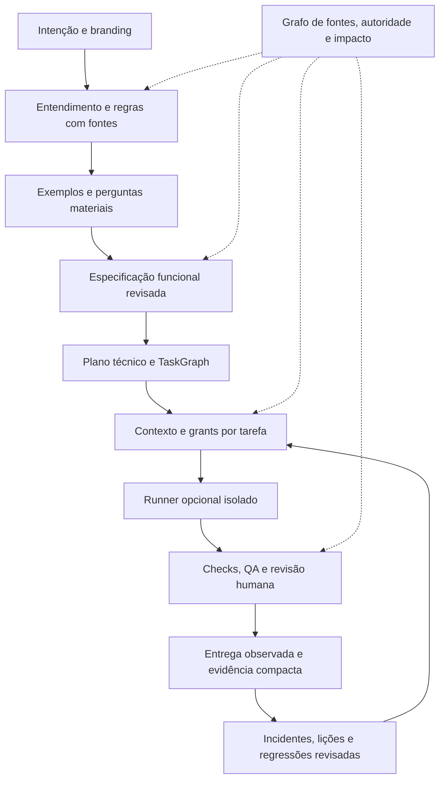

# Esteira de engenharia por projeto

Registro: 16/11/2026. Escopo solicitado pelo PO: estudar práticas de engenharia,
adaptar as ideias úteis e incorporá-las ao Product Backlog. Estado: **refinamento**.
Este documento não inicia sprint, executa agentes ou altera defaults.

A fonte canônica dos critérios é `project-definition/project.yaml`, AHC-031 a
AHC-042. A fila com dependências, primeiras fatias e verificações está em
`planning/engineering-evolution.json`. Cada item tem quatro etapas planejadas:
design, implementação, verificação e review. Datas, capacidade e estimativas
continuam sem confirmação; ordem de dependências não é autorização de execução.

## Direção de produto

Compilar um harness deve produzir também o caminho verificável pelo qual a equipe
transforma intenção em comportamento validado. Esse caminho deriva do projeto:
regras e exemplos antes de delegação, decisões materiais explícitas, contexto por
etapa, execução com autoridade limitada e aprendizado a partir de evidência.
Projetos sem UI, sem delegação ou sem LLM devem continuar válidos.

O compilador continua gerando artefatos em pasta nova. Executar código, preparar
máquina, instalar um harness e publicar mudanças são fronteiras diferentes, com
políticas e permissões próprias. O fluxo acima descreve o alvo, não funcionalidade
já entregue.

## Seleção das ideias e adaptação

A análise foi estática: documentação de arquitetura/processo, contratos,
implementações de orquestração, contexto, especialização, CI, exemplos, design,
preparo de ambiente e testes de invariantes. Ver código e testes demonstra uma
técnica inspecionável; não comprova sua execução, desempenho ou adequação aqui.
Não foram executados scripts, serviços ou agentes durante o estudo. A adaptação
abaixo é uma especificação independente; nenhum código, persona, pacote de design,
regra de negócio ou conteúdo proprietário foi importado.

| Necessidade no compilador | Ideia adotada | Adaptação e limite | Destino |
|---|---|---|---|
| Entendimento não deve saltar direto para código | Mudança com spec funcional e exemplos concretos | Perguntas materiais antes da decisão; exemplos sintéticos e fronteiras justificadas, sem quota universal de exemplos | 031 |
| Citação válida não basta para escolher a regra vigente | Grafo regra → decisão → requisito → tarefa → teste | Autoridade por projeto/campo, fontes rejeitadas ou substituídas visíveis; ranking de busca não resolve conflito | 032 |
| Contexto amplo pode esconder obrigações | Receita de contexto por etapa e papel | Limite rígido, razão da inclusão, orçamento de tokens declarado; mínimo obrigatório excessivo retorna insuficiência | 033 |
| Persona não é permissão | Especialista composto e grant atenuado | Filho contido no pai e na task; orçamento agregado reservado, revalidação no reuso e sem hierarquia fixa de providers | 034 |
| DAG estrutural não executa nem isola tarefas | Workspaces por tarefa e integração verificada | Baseline sequencial antes de paralelismo; recursos, cancelamento, fan-in e efeitos incertos explícitos | 035 |
| Repetir checks custa tempo, mas reusar errado esconde falhas | CI por snapshot e seleção conservadora | Cache vinculado a HEAD/base/política/ambiente; check parcial não substitui integração completa | 036 |
| Falhas de ambiente não devem virar falhas do modelo | Diagnóstico de prontidão por papel | Padrão somente leitura; versões e recursos desconhecidos explícitos; instalação é operação separada | 037 |
| Branding deve participar com evidência real | Pacote normalizado de tokens, componentes e estados | Adapter opt-in, formato neutro e limites de importação; visual não concede autorização de negócio | 038 |
| Incidente útil deve gerar regressão verificável | Mineração assistida de casos do histórico | Candidato draft com curador, reprodução e oráculo; patch futuro oculto e dados expostos nunca voltam a holdout | 039 |
| ML pode piorar um roteamento sem evidência | Roteamento, risco e acoplamento em sombra | Registrar sugestão e ação efetiva separadamente; exigir suporte estatístico e qualidade semântica antes de ativação | 040 |
| PO precisa entender o que está aguardando decisão | Dossiê por mudança e métricas de fluxo | Dono, regra, alternativas e evidência; maioria de modelos e silêncio não aprovam uma decisão | 041 |
| Documentação e especialização podem duplicar contexto | Packs versionados e mapa documental | Fonte normativa única, compatibilidade, direitos de uso e vistas geradas; histórico imutável preservado | 042 |

## Reaproveitar o que já existe

Não criar um segundo sistema de memória, outro Scrum Master ou uma nova revisora.
Nexo, Vera, EngineeringMemory, Evidence Pack, TaskGraph e os gates de execução
continuam como fundações. As histórias novas preenchem diferenças específicas:

- AHC-031/032 ampliam AHC-019/022 com mudança, exemplos e impacto entre artefatos.
- AHC-033 refina AHC-006; AHC-034 e 042 refinam AHC-005/015/017/020.
- AHC-035 amplia AHC-008/010; não altera o runner de campanhas de uso único.
- AHC-036 estende checks e QA de AHC-004/030; AHC-041 alimenta Nexo/Vera existentes.
- AHC-037 complementa os perfis de AHC-024; AHC-038 estende intake/blueprint por adapter.
- AHC-039 amplia AHC-018 com corpus verificável; AHC-040 depende da qualificação e
  dos experimentos de AHC-023/025 e não é pré-requisito para um harness útil.

Os critérios anteriores não foram reescritos. A diferença entre equipe interna
do compilador e especialistas emitidos para projetos alvo continua explícita.
Nenhum nome, nicho, framework ou papel local vira enum universal.

## Ordem sugerida e primeiras fatias

| Onda | Itens | Resultado da primeira fatia | Dependências externas à onda |
|---|---|---|---|
| 1 — comportamento e fontes | 031, depois 032 | Regra, exemplos e pergunta ligados a uma spec e teste; invalidação de review afetado | 003, 015, 019, 021, 022 |
| 2 — contexto, feedback e operação | 033, 036, 037, 041 | Context packet limitado, receipt por revisão, doctor e dossiê CLI | 004, 006, 024, 027, 028, 030 e revisão de 032 |
| 3 — especialização e intake | 034, 038, 042 | Um grant revalidável, pacote de design neutro opcional e knowledge pack versionado | 001, 005, 007, 015, 017, 020 e revisão de 033 |
| 4 — execução e regressão | 035, 039 | Uma tarefa isolada com integração sequencial e um caso draft derivado de incidente | 008, 010, 018 e revisões de 034/036 |
| 5 — aprendizado em sombra | 040 | Recomendações observadas sem mudar a decisão efetiva | 023, 025 e revisões de 035/039 |

Ondas são agrupamentos de refinamento. As dependências individuais estão no
manifesto; um item na mesma onda ainda pode depender do review de outro. Nenhuma
dependência aberta é marcada como concluída para permitir gerar tarefas executáveis.
A primeira seleção recomendada é **uma fatia de AHC-031**, depois dos gates de
entendimento que a sustentam; não selecionar todas as doze histórias numa sprint.

A Sprint 2.6 mantém seu escopo e seus gates. Os oito outputs de desenvolvimento
v4.2 aprovados são evidência localizada; revisão por critério de AHC-021/022 e
avaliação independente permanecem necessárias antes de qualificação/promoção.
Refinamento offline das histórias novas pode avançar enquanto esses gates estão
abertos; execução com modelo, mudança de defaults ou treinamento exigem seu
próprio escopo e orçamento.

## Técnicas que exigem correção antes da adoção

1. **Contexto não pode ter exceção invisível ao teto.** Incluir sempre o primeiro
   item mesmo que ultrapasse o limite quebra o contrato. Separar sumário mínimo
   e fontes carregadas sob demanda; se obrigações não cabem, devolver insuficiência.
2. **Busca não escolhe a verdade.** Peso de autoridade auxilia seleção; conflitos
   de fontes vigentes continuam como perguntas, não se resolvem pelo maior score.
3. **Delegação precisa de reserva agregada.** Limitar cada filho isoladamente a
   uma fração do pai não evita somar mais do que o saldo com vários filhos. Reserva
   e liquidação são atômicas; falhas continuam cobradas.
4. **Sombra não fabrica contrafactuais.** Probabilidade de uma sugestão não é a
   propensão da ação executada. Logs de uma política determinística podem não ter
   suporte para comparar ações alternativas por avaliação off-policy.
5. **Avaliar contexto com o índice de hoje pode vazar o futuro.** O corpus e o
   índice precisam de corte temporal e divisão por projeto/família; métricas de
   recuperação não substituem groundedness ou correção do resultado.
6. **Gates sintáticos e maioria de juízes não aprovam negócio.** Pareceres ajudam
   a localizar problemas e divergências; o aceite continua vinculado ao humano,
   ao escopo e ao snapshot corretos.

## O que fica fora desta incorporação

- Aprovação por silêncio ou passagem automática de portão por cronômetro.
- Ramificação permanente de integração, alterações na política Git atual ou
  proibição universal de edição humana de código.
- Rede, SDK específico, modelos ordenados por suposta inteligência e agents
  obrigatórios para todo projeto.
- Instalação, escrita remota, downloads, alteração de energia ou inferência pelo estudo.
- Thresholds universais de dataset, esforço, custo, número de juízes ou paralelismo.
- Cópia de material restrito, mudança da Apache-2.0, importação de personas ou
  documentação contendo informações particulares de outra organização.

## Verificação e resultado observável

O incremento desta solicitação entrega **backlog e plano verificáveis**, não as
doze funcionalidades. Conferir carga tipada do manifesto, referências e DAG,
critérios por história, unicidade na fila, ordem de dependências e preservação
dos scopes/status das sprints. Os TaskGraphs históricos recebem apenas o grafo
fonte atualizado; tasks e critérios selecionados continuam iguais. Schemas e
programas de geração não mudam. Memória registra a decisão de adoção e seus
limites, sem inventar lições verificadas ou resultados de execução externa.
